<div class="cover">

<p class="inst">[Institute / University Name]</p>
<p class="dept">Department of [Computer Science and Engineering]</p>

# Bookstore Inventory and Online Sales Management System

<p class="sub">Database Management Systems (DBMS) – Project Report</p>

| | |
|---|---|
| **Submitted by** | [Student Name 1] – [Roll No.]<br>[Student Name 2] – [Roll No.]<br>[Student Name 3] – [Roll No.] |
| **Course** | Database Management Systems ([Course Code]) |
| **Faculty** | [Faculty Name] |
| **Academic Year** | [2026 – 2027] |

</div>

<div class="pb"></div>

## Table of Contents {.unnumbered}

1. Abstract
2. Introduction and Problem Statement
3. Objectives and Scope
4. Software and Hardware Requirements
5. ER Diagram
6. Relational Schema and Normalization
7. Data Dictionary
8. SQL Commands Used (DDL, DML) with Sample Outputs
9. Queries with Outputs
10. UI Design and Screenshots
11. Implementation Details
12. Testing
13. Conclusion and Future Enhancements
14. References
15. Contribution of Each Member
16. Appendix: GitHub Repository Link

<div class="pb"></div>

## 1. Abstract

Small bookstores often track inventory and sales manually or in disconnected spreadsheets, which makes stock tracking, order handling and record retrieval slow and error-prone. This project presents a **Bookstore Inventory and Online Sales Management System** that keeps all of this data in one relational database.

The database is implemented in **MySQL 8** with six normalized tables (categories, authors, books, customers, orders and order items). Primary keys, foreign keys, unique, check and not-null constraints enforce integrity. **Triggers** reduce stock automatically when an order line is inserted and block overselling. Indexes and views support fast retrieval. A **Node.js + Express** server with the `mysql2` driver exposes a REST API, and a browser-based interface built with HTML, CSS and JavaScript lets staff manage books, authors, categories and customers and place and track online orders.

The report documents the design (ER diagram, relational schema, normalization, data dictionary), the SQL used, sample queries with outputs, the user interface, the implementation and the tests performed.

**Keywords:** DBMS, MySQL, inventory management, online orders, triggers, Node.js, Express.

## 2. Introduction and Problem Statement

### 2.1 Background
A bookstore must know at every moment which titles it has, how many copies are in stock, who ordered what, and how much has been sold. When this information lives in notebooks or separate files, it is easy to lose track of stock, sell a book that is no longer available, or spend a long time finding a record.

### 2.2 Problem statement
> Small bookstores may keep inventory and sales records manually or in disconnected systems. This makes stock tracking, order management and record retrieval difficult.

### 2.3 Proposed solution
A centralized database-driven application in which:

- the inventory, authors, categories, customers and orders are stored in related tables;
- online orders are placed through a web interface;
- stock is reduced automatically by the database whenever a sale is recorded;
- records can be searched and retrieved quickly with SQL queries, indexes and views.

## 3. Objectives and Scope

### 3.1 Objectives

1. Maintain a centralized bookstore inventory.
2. Store customer, author and category data.
3. Manage online orders.
4. Automatically reduce stock after sales.
5. Provide fast database-based retrieval.
6. Maintain integrity with primary keys, foreign keys and constraints.

### 3.2 Intended users

| User | Use of the system |
|---|---|
| Bookstore administrator | Maintains books, authors, categories; reviews dashboard and revenue |
| Store staff | Adds and updates stock, looks up books |
| Online customers / orders management staff | Place orders; track and update order status |

### 3.3 Scope

**In scope:** book inventory, customers, authors, categories, orders and order items, with a web interface for these.

**Out of scope (see future enhancements):** payment gateway, user login and roles, shipping integration, returns and refunds, purchase orders from suppliers.

## 4. Software and Hardware Requirements

### 4.1 Software

| Component | Details |
|---|---|
| Database | MySQL 8.x (MySQL Workbench used for design and verification) |
| Back end | Node.js (LTS), Express 4, `mysql2` 3, `dotenv`, `cors` |
| Front end | HTML5, CSS3, JavaScript (no framework) |
| Browser | Any current browser (Chrome, Edge, Firefox, Safari) |
| Operating system | Windows, macOS or Linux (developed and tested on macOS) |

### 4.2 Hardware (minimum)

| Component | Requirement |
|---|---|
| Processor | Dual-core, 2 GHz |
| Memory | 4 GB RAM |
| Storage | 1 GB free disk space |
| Network | Not needed for local use; LAN or internet for multi-user access |

## 5. ER Diagram

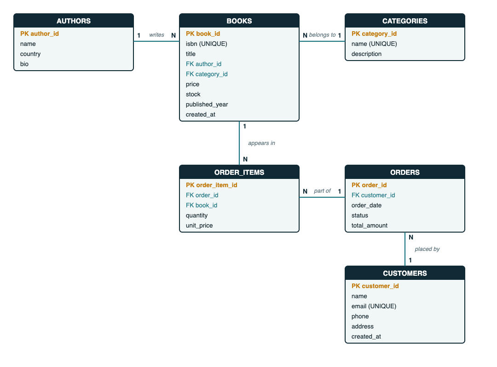{ width=95% }

### 5.1 Entities
`CATEGORIES`, `AUTHORS`, `BOOKS`, `CUSTOMERS`, `ORDERS`, `ORDER_ITEMS`.

### 5.2 Relationships

| Relationship | Cardinality | Implemented by |
|---|---|---|
| Author **writes** Book | One author, many books (1 : N) | `books.author_id` → `authors.author_id` |
| Category **contains** Book | One category, many books (1 : N) | `books.category_id` → `categories.category_id` |
| Customer **places** Order | One customer, many orders (1 : N) | `orders.customer_id` → `customers.customer_id` |
| Order **has** Order item | One order, many items (1 : N) | `order_items.order_id` → `orders.order_id` |
| Book **appears in** Order item | One book, many items (1 : N) | `order_items.book_id` → `books.book_id` |

`ORDERS` and `BOOKS` have a many-to-many relationship, resolved by the associative entity `ORDER_ITEMS` (which also stores `quantity` and `unit_price`).

## 6. Relational Schema and Normalization

### 6.1 Relational schema
Primary keys are underlined in the usual notation and shown here in **bold**; foreign keys are marked with *FK*.

- **categories** (**category_id**, name, description)
- **authors** (**author_id**, name, country, bio)
- **books** (**book_id**, isbn, title, *author_id* FK, *category_id* FK, price, stock, published_year, created_at)
- **customers** (**customer_id**, name, email, phone, address, created_at)
- **orders** (**order_id**, *customer_id* FK, order_date, status, total_amount)
- **order_items** (**order_item_id**, *order_id* FK, *book_id* FK, quantity, unit_price)

### 6.2 Normalization

**First Normal Form (1NF).** Every attribute holds a single atomic value and every table has a primary key. A book has exactly one author and one category column; an order's several books are stored as separate rows in `order_items` instead of a repeating group.

**Second Normal Form (2NF).** All tables use a single-column surrogate primary key, so no non-key attribute can depend on part of a key. For `order_items`, `quantity` and `unit_price` depend on the whole order line. A unique key on `(order_id, book_id)` prevents the same book appearing twice in one order.

**Third Normal Form (3NF).** There are no transitive dependencies:

- author details (`country`, `bio`) are in `authors`, not repeated in `books`;
- category description is in `categories`;
- customer details are in `customers`, not repeated in each order.

**Deliberate denormalization.** Two attributes store data that could be recomputed, for good reasons:

- `order_items.unit_price` keeps the price **at the time of sale**. If the book's price changes later, old orders must not change.
- `orders.total_amount` stores the order total so that order lists do not need to sum the items every time. It is calculated once, inside the same transaction that inserts the items.

## 7. Data Dictionary

### 7.1 categories

| Column | Data type | Constraints | Description |
|---|---|---|---|
| category_id | INT | PRIMARY KEY, AUTO_INCREMENT | Category identifier |
| name | VARCHAR(80) | NOT NULL, UNIQUE | Category name |
| description | VARCHAR(255) | NULL | Short description |

### 7.2 authors

| Column | Data type | Constraints | Description |
|---|---|---|---|
| author_id | INT | PRIMARY KEY, AUTO_INCREMENT | Author identifier |
| name | VARCHAR(120) | NOT NULL, UNIQUE | Author name |
| country | VARCHAR(80) | NULL | Country |
| bio | VARCHAR(500) | NULL | Short biography |

### 7.3 books

| Column | Data type | Constraints | Description |
|---|---|---|---|
| book_id | INT | PRIMARY KEY, AUTO_INCREMENT | Book identifier |
| isbn | VARCHAR(20) | NOT NULL, UNIQUE | ISBN |
| title | VARCHAR(200) | NOT NULL, INDEX | Title |
| author_id | INT | NOT NULL, FK → authors, ON DELETE RESTRICT, ON UPDATE CASCADE | Author |
| category_id | INT | NOT NULL, FK → categories, ON DELETE RESTRICT, ON UPDATE CASCADE | Category |
| price | DECIMAL(10,2) | NOT NULL, CHECK (price >= 0) | Selling price |
| stock | INT | NOT NULL, DEFAULT 0, CHECK (stock >= 0) | Copies in stock |
| published_year | SMALLINT | NULL | Year of publication |
| created_at | TIMESTAMP | NOT NULL, DEFAULT CURRENT_TIMESTAMP | Record creation time |

### 7.4 customers

| Column | Data type | Constraints | Description |
|---|---|---|---|
| customer_id | INT | PRIMARY KEY, AUTO_INCREMENT | Customer identifier |
| name | VARCHAR(120) | NOT NULL | Customer name |
| email | VARCHAR(120) | NOT NULL, UNIQUE | Email address |
| phone | VARCHAR(20) | NULL | Phone number |
| address | VARCHAR(255) | NULL | Delivery address |
| created_at | TIMESTAMP | NOT NULL, DEFAULT CURRENT_TIMESTAMP | Registration time |

### 7.5 orders

| Column | Data type | Constraints | Description |
|---|---|---|---|
| order_id | INT | PRIMARY KEY, AUTO_INCREMENT | Order identifier |
| customer_id | INT | NOT NULL, FK → customers, ON DELETE RESTRICT, ON UPDATE CASCADE | Customer |
| order_date | TIMESTAMP | NOT NULL, DEFAULT CURRENT_TIMESTAMP, INDEX | Date and time of order |
| status | ENUM | NOT NULL, DEFAULT 'PLACED' (PLACED, SHIPPED, DELIVERED, CANCELLED) | Order status |
| total_amount | DECIMAL(12,2) | NOT NULL, DEFAULT 0, CHECK (total_amount >= 0) | Order total |

### 7.6 order_items

| Column | Data type | Constraints | Description |
|---|---|---|---|
| order_item_id | INT | PRIMARY KEY, AUTO_INCREMENT | Line identifier |
| order_id | INT | NOT NULL, FK → orders, ON DELETE CASCADE, ON UPDATE CASCADE | Order |
| book_id | INT | NOT NULL, FK → books, ON DELETE RESTRICT, ON UPDATE CASCADE | Book |
| quantity | INT | NOT NULL, CHECK (quantity > 0) | Copies ordered |
| unit_price | DECIMAL(10,2) | NOT NULL, CHECK (unit_price >= 0) | Price per copy at time of sale |

`UNIQUE (order_id, book_id)` prevents duplicate lines in one order.

### 7.7 Table structures as shown by MySQL (`DESCRIBE`)

```text
@@Q17@@
@@Q18@@
@@Q19@@
@@Q20@@
@@Q21@@
@@Q22@@
```

## 8. SQL Commands Used (DDL, DML) with Sample Outputs

The complete script is in `database/schema.sql`.

### 8.1 DDL – database and tables

```sql
CREATE DATABASE bookstore_db CHARACTER SET utf8mb4 COLLATE utf8mb4_unicode_ci;
USE bookstore_db;

CREATE TABLE categories (
    category_id   INT AUTO_INCREMENT PRIMARY KEY,
    name          VARCHAR(80)  NOT NULL UNIQUE,
    description   VARCHAR(255)
) ENGINE=InnoDB;

CREATE TABLE authors (
    author_id     INT AUTO_INCREMENT PRIMARY KEY,
    name          VARCHAR(120) NOT NULL,
    country       VARCHAR(80),
    bio           VARCHAR(500),
    UNIQUE KEY uq_author_name (name)
) ENGINE=InnoDB;

CREATE TABLE books (
    book_id       INT AUTO_INCREMENT PRIMARY KEY,
    isbn          VARCHAR(20)   NOT NULL UNIQUE,
    title         VARCHAR(200)  NOT NULL,
    author_id     INT           NOT NULL,
    category_id   INT           NOT NULL,
    price         DECIMAL(10,2) NOT NULL,
    stock         INT           NOT NULL DEFAULT 0,
    published_year SMALLINT,
    created_at    TIMESTAMP     NOT NULL DEFAULT CURRENT_TIMESTAMP,
    CONSTRAINT chk_book_price CHECK (price >= 0),
    CONSTRAINT chk_book_stock CHECK (stock >= 0),
    CONSTRAINT fk_book_author   FOREIGN KEY (author_id)   REFERENCES authors(author_id)
        ON UPDATE CASCADE ON DELETE RESTRICT,
    CONSTRAINT fk_book_category FOREIGN KEY (category_id) REFERENCES categories(category_id)
        ON UPDATE CASCADE ON DELETE RESTRICT,
    INDEX idx_book_title (title),
    INDEX idx_book_author (author_id),
    INDEX idx_book_category (category_id)
) ENGINE=InnoDB;

CREATE TABLE customers (
    customer_id   INT AUTO_INCREMENT PRIMARY KEY,
    name          VARCHAR(120) NOT NULL,
    email         VARCHAR(120) NOT NULL UNIQUE,
    phone         VARCHAR(20),
    address       VARCHAR(255),
    created_at    TIMESTAMP NOT NULL DEFAULT CURRENT_TIMESTAMP
) ENGINE=InnoDB;

CREATE TABLE orders (
    order_id      INT AUTO_INCREMENT PRIMARY KEY,
    customer_id   INT NOT NULL,
    order_date    TIMESTAMP NOT NULL DEFAULT CURRENT_TIMESTAMP,
    status        ENUM('PLACED','SHIPPED','DELIVERED','CANCELLED') NOT NULL DEFAULT 'PLACED',
    total_amount  DECIMAL(12,2) NOT NULL DEFAULT 0,
    CONSTRAINT chk_order_total CHECK (total_amount >= 0),
    CONSTRAINT fk_order_customer FOREIGN KEY (customer_id) REFERENCES customers(customer_id)
        ON UPDATE CASCADE ON DELETE RESTRICT,
    INDEX idx_order_customer (customer_id),
    INDEX idx_order_date (order_date)
) ENGINE=InnoDB;

CREATE TABLE order_items (
    order_item_id INT AUTO_INCREMENT PRIMARY KEY,
    order_id      INT NOT NULL,
    book_id       INT NOT NULL,
    quantity      INT NOT NULL,
    unit_price    DECIMAL(10,2) NOT NULL,
    CONSTRAINT chk_item_qty   CHECK (quantity > 0),
    CONSTRAINT chk_item_price CHECK (unit_price >= 0),
    CONSTRAINT fk_item_order FOREIGN KEY (order_id) REFERENCES orders(order_id)
        ON UPDATE CASCADE ON DELETE CASCADE,
    CONSTRAINT fk_item_book  FOREIGN KEY (book_id)  REFERENCES books(book_id)
        ON UPDATE CASCADE ON DELETE RESTRICT,
    UNIQUE KEY uq_order_book (order_id, book_id),
    INDEX idx_item_book (book_id)
) ENGINE=InnoDB;
```

### 8.2 DDL – triggers (automatic stock control)

```sql
DELIMITER $$

CREATE TRIGGER trg_items_before_insert
BEFORE INSERT ON order_items
FOR EACH ROW
BEGIN
    DECLARE available INT;
    SELECT stock INTO available FROM books WHERE book_id = NEW.book_id FOR UPDATE;
    IF available IS NULL OR available < NEW.quantity THEN
        SIGNAL SQLSTATE '45000' SET MESSAGE_TEXT = 'Insufficient stock for requested book';
    END IF;
END$$

CREATE TRIGGER trg_items_after_insert
AFTER INSERT ON order_items
FOR EACH ROW
BEGIN
    UPDATE books SET stock = stock - NEW.quantity WHERE book_id = NEW.book_id;
END$$

CREATE TRIGGER trg_items_after_delete
AFTER DELETE ON order_items
FOR EACH ROW
BEGIN
    UPDATE books SET stock = stock + OLD.quantity WHERE book_id = OLD.book_id;
END$$

DELIMITER ;
```

Triggers installed in the database:

```text
@@Q16@@
```

### 8.3 DDL – views

```sql
CREATE VIEW v_book_catalog AS
SELECT b.book_id, b.isbn, b.title, b.price, b.stock, b.published_year,
       a.author_id, a.name AS author, c.category_id, c.name AS category
FROM books b
JOIN authors a    ON a.author_id = b.author_id
JOIN categories c ON c.category_id = b.category_id;

CREATE VIEW v_order_summary AS
SELECT o.order_id, o.order_date, o.status, o.total_amount,
       cu.customer_id, cu.name AS customer, cu.email,
       COALESCE(SUM(oi.quantity), 0) AS total_items
FROM orders o
JOIN customers cu ON cu.customer_id = o.customer_id
LEFT JOIN order_items oi ON oi.order_id = o.order_id
GROUP BY o.order_id, o.order_date, o.status, o.total_amount,
         cu.customer_id, cu.name, cu.email;
```

### 8.4 DML – inserting data

```sql
INSERT INTO categories (name, description) VALUES
 ('Fiction', 'Novels and short stories'),
 ('Science', 'Popular science and textbooks'),
 ('Technology', 'Programming and computing'),
 ('History', 'Historical works and biographies'),
 ('Self-Help', 'Personal development');

INSERT INTO authors (name, country, bio) VALUES
 ('George Orwell', 'United Kingdom', 'Author of dystopian classics'),
 ('Yuval Noah Harari', 'Israel', 'Historian and bestselling author'),
 ('Robert C. Martin', 'United States', 'Software engineer and author of Clean Code'),
 ('Paulo Coelho', 'Brazil', 'Novelist, author of The Alchemist'),
 ('James Clear', 'United States', 'Writer on habits and self-improvement'),
 ('Stephen Hawking', 'United Kingdom', 'Theoretical physicist');

INSERT INTO books (isbn, title, author_id, category_id, price, stock, published_year) VALUES
 ('9780451524935', '1984',                    1, 1, 299.00, 25, 1949),
 ('9780452284241', 'Animal Farm',             1, 1, 199.00, 30, 1945),
 ('9780062316097', 'Sapiens',                 2, 4, 499.00, 18, 2011),
 ('9780132350884', 'Clean Code',              3, 3, 699.00, 12, 2008),
 ('9780061122415', 'The Alchemist',           4, 1, 349.00, 40, 1988),
 ('9780735211292', 'Atomic Habits',           5, 5, 599.00, 22, 2018),
 ('9780553380163', 'A Brief History of Time', 6, 2, 449.00, 15, 1988),
 ('9780134494166', 'Clean Architecture',      3, 3, 749.00,  9, 2017);

INSERT INTO customers (name, email, phone, address) VALUES
 ('Aarav Mehta', 'aarav@example.com', '9876500001', '12 MG Road, Pune'),
 ('Diya Sharma', 'diya@example.com',  '9876500002', '45 Park Street, Kolkata'),
 ('Rohan Verma', 'rohan@example.com', '9876500003', '8 Lake View, Bengaluru');
```

Sample output after the load and three demo orders:

```text
@@Q0@@
@@Q1@@
@@Q2@@
```

### 8.5 DML – placing an order (insert, update)

The application runs these statements in one transaction. The trigger checks and reduces the stock when the order line is inserted.

```sql
START TRANSACTION;
INSERT INTO orders (customer_id) VALUES (1);
INSERT INTO order_items (order_id, book_id, quantity, unit_price) VALUES (1, 4, 2, 699.00);
INSERT INTO order_items (order_id, book_id, quantity, unit_price) VALUES (1, 1, 1, 299.00);
UPDATE orders SET total_amount = 1697.00 WHERE order_id = 1;
COMMIT;
```

Stock after the three demo orders (Clean Code 12 → 10, 1984 25 → 24, Sapiens 18 → 15, Atomic Habits 22 → 20, The Alchemist 40 → 36):

```text
@@Q15@@
```

### 8.6 DML – update and delete

```sql
UPDATE books SET price = 649.00, stock = stock + 10 WHERE book_id = 4;   -- price change and restock
UPDATE orders SET status = 'SHIPPED' WHERE order_id = 2;                 -- order status
DELETE FROM books WHERE book_id = 9;                                     -- remove a book never ordered
```

### 8.7 Constraint violations (sample outputs)

```text
@@Q23@@
@@Q24@@
@@Q25@@
@@Q26@@
```

## 9. Queries with Outputs

All outputs below were produced by MySQL 8.4 on the project database after three demo orders were placed.

**Q1. Books in the Technology category (using a view).**

```text
@@Q3@@
```

**Q2. Books priced between ₹300 and ₹600, most expensive first.**

```text
@@Q4@@
```

**Q3. Book, author and category (three-table join).**

```text
@@Q5@@
```

**Q4. Number of titles and units per author (LEFT JOIN, GROUP BY).**

```text
@@Q6@@
```

**Q5. Categories with more than 40 units in stock (HAVING).**

```text
@@Q7@@
```

**Q6. Order summary (view).**

```text
@@Q8@@
```

**Q7. Order lines with line totals.**

```text
@@Q9@@
```

**Q8. Customer-wise orders and amount spent.**

```text
@@Q10@@
```

**Q9. Top 3 books by revenue.**

```text
@@Q11@@
```

**Q10. Books with below-average stock (subquery).**

```text
@@Q12@@
```

**Q11. Books never ordered (NOT IN subquery).**

```text
@@Q13@@
```

**Q12. Orders per status.**

```text
@@Q14@@
```

## 10. UI Design and Screenshots

The interface is a single-page web application with a sidebar for navigation (Dashboard, Books, Orders, Customers, Authors, Categories). Colours follow the project presentation: navy, teal and orange. Data is loaded from the REST API; every change is saved in MySQL.

### 10.1 Dashboard
Shows the number of titles, units in stock, low-stock titles (5 or fewer), customers, active orders and revenue, plus low-stock and recent-order tables.

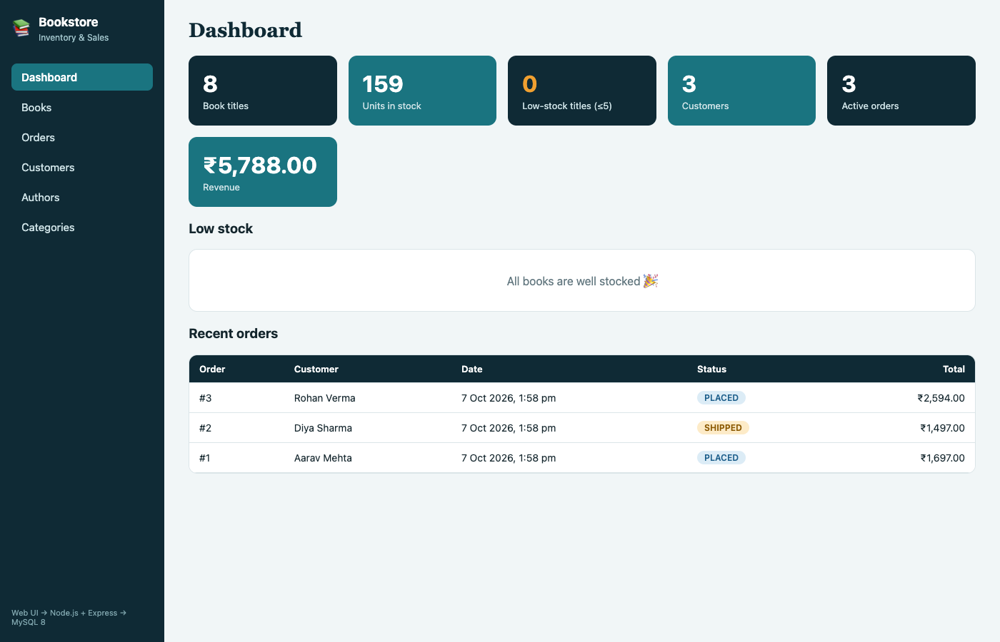{ width=95% }

### 10.2 View Books
Lists all books with search by title, author or ISBN and filters by category and author. Stock is colour-coded.

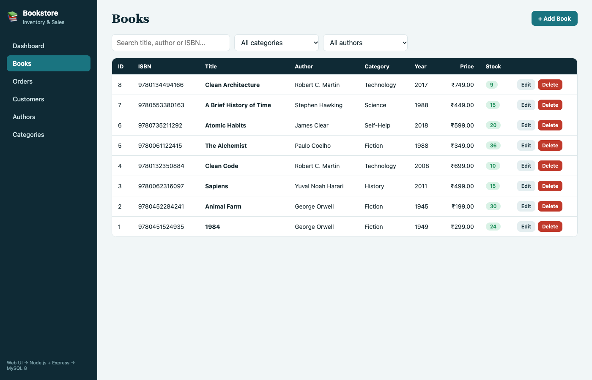{ width=95% }

### 10.3 Add Book

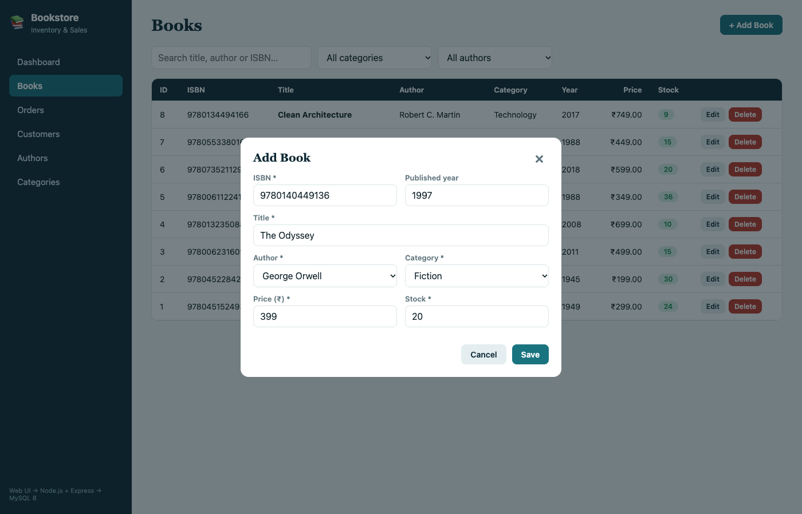{ width=95% }

After saving, the new book appears at the top of the list (here "The Odyssey").

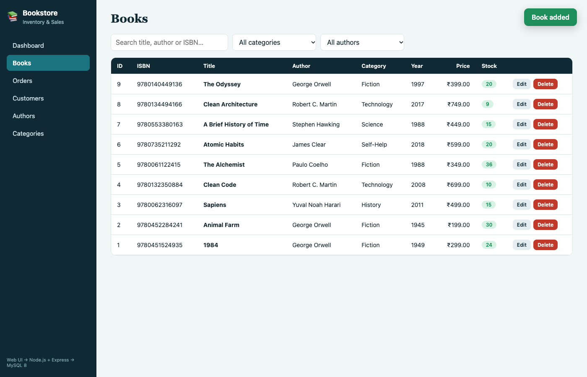{ width=95% }

### 10.4 Delete Book
After the Delete button is confirmed, the book is removed from the list and from MySQL.

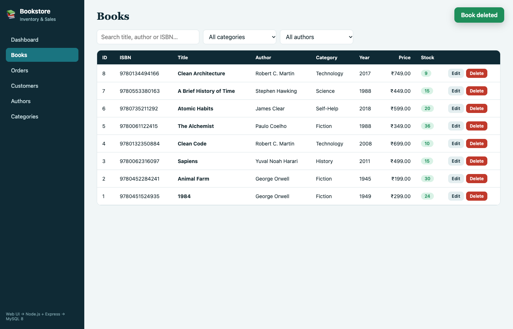{ width=95% }

### 10.5 Orders

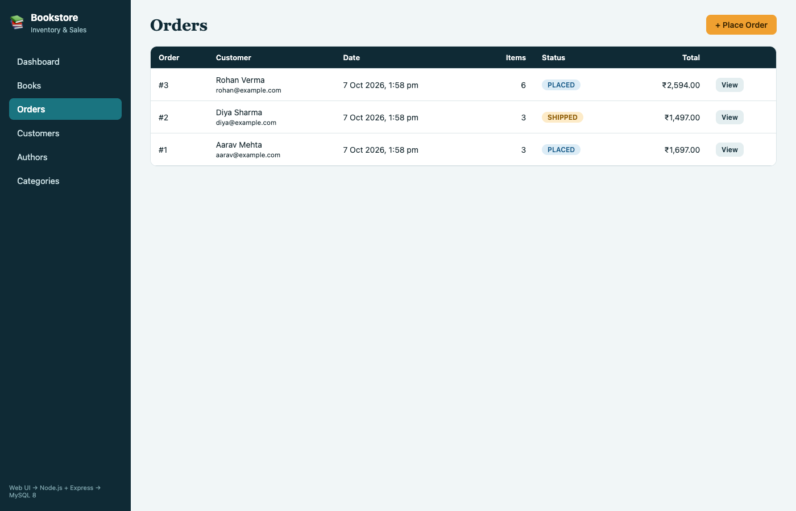{ width=95% }

### 10.6 Place Order
The user selects a customer and one or more books with quantities; the total is calculated live. Only books with stock are offered.

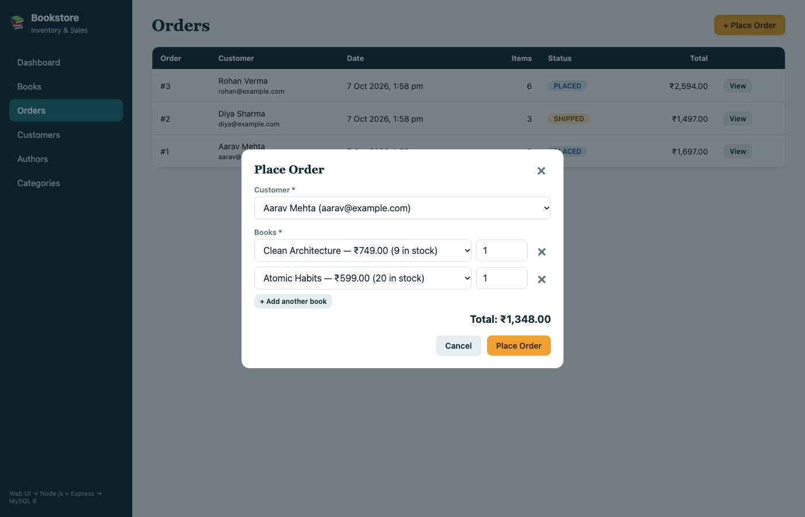{ width=95% }

### 10.7 Order details
Shows the order lines and allows the status to be moved to Shipped or Delivered, or the order to be cancelled (stock is returned).

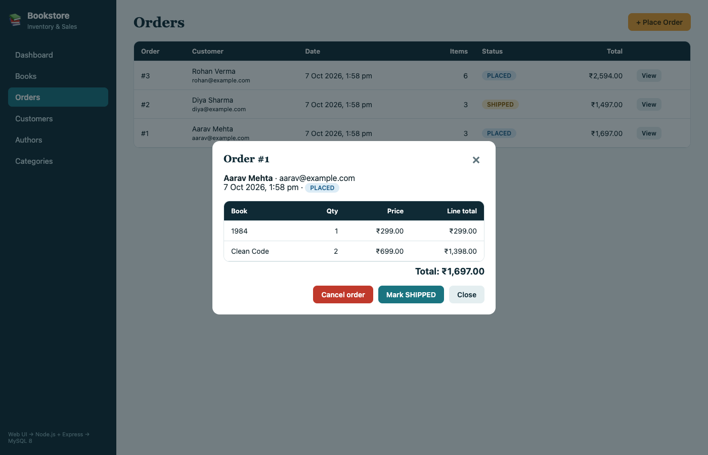{ width=95% }

### 10.8 Customers and Authors

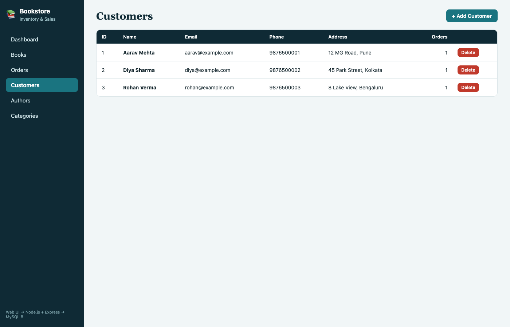{ width=95% }

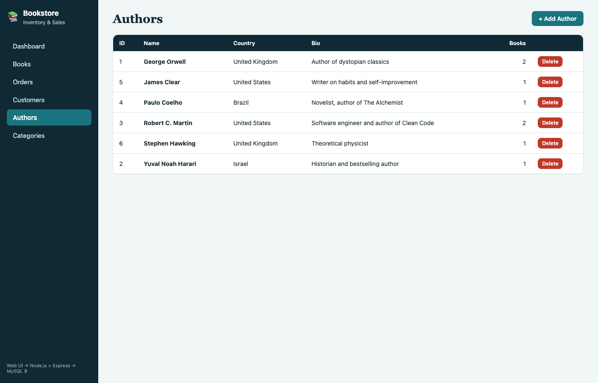{ width=95% }

## 11. Implementation Details

### 11.1 Architecture

```text
Web UI (HTML · CSS · JavaScript)  ──HTTP/JSON──▶  Node.js + Express  ──mysql2──▶  MySQL 8
        public/                                      server.js, db.js            bookstore_db
```

### 11.2 Project structure

| File | Purpose |
|---|---|
| `database/schema.sql` | Tables, constraints, triggers, views and sample data |
| `database/setup.js` | Runs `schema.sql` from Node (`npm run setup-db`) |
| `db.js` | MySQL connection pool |
| `server.js` | Express server and REST API |
| `public/index.html`, `style.css`, `app.js` | Front end |
| `.env` | Database host, user, password, name and port |

### 11.3 Database connectivity (`db.js`)

```javascript
const mysql = require('mysql2/promise');

const pool = mysql.createPool({
  host: process.env.DB_HOST || 'localhost',
  port: Number(process.env.DB_PORT) || 3306,
  user: process.env.DB_USER || 'root',
  password: process.env.DB_PASSWORD || '',
  database: process.env.DB_NAME || 'bookstore_db',
  waitForConnections: true,
  connectionLimit: 10,
  decimalNumbers: true,
});
module.exports = pool;
```

All queries use placeholders (`?`), so user input is never concatenated into SQL, which protects against SQL injection.

### 11.4 REST API

| Method | Endpoint | Action |
|---|---|---|
| GET, POST | `/api/books` | List (with search and filters) / add a book |
| PUT, DELETE | `/api/books/:id` | Update / delete a book |
| GET, POST, DELETE | `/api/authors`, `/api/categories`, `/api/customers` | Manage reference data |
| GET, POST | `/api/orders` | List / place an order |
| GET | `/api/orders/:id` | Order with its lines |
| PATCH | `/api/orders/:id/status` | Ship, deliver or cancel |
| GET | `/api/stats` | Dashboard figures |

### 11.5 Key code – placing an order with a transaction

```javascript
const conn = await pool.getConnection();
try {
  await conn.beginTransaction();
  const [o] = await conn.query('INSERT INTO orders (customer_id) VALUES (?)', [customer_id]);
  let total = 0;
  for (const [bookId, qty] of merged) {
    const [[book]] = await conn.query('SELECT price, title FROM books WHERE book_id = ?', [bookId]);
    // the trigger rejects the line if stock is insufficient, and reduces stock otherwise
    await conn.query(
      'INSERT INTO order_items (order_id, book_id, quantity, unit_price) VALUES (?, ?, ?, ?)',
      [o.insertId, bookId, qty, book.price]);
    total += book.price * qty;
  }
  await conn.query('UPDATE orders SET total_amount = ? WHERE order_id = ?', [total.toFixed(2), o.insertId]);
  await conn.commit();
} catch (e) {
  await conn.rollback();   // nothing is saved if any line fails
  throw e;
} finally {
  conn.release();
}
```

If any line fails (for example, not enough stock), the whole order is rolled back, so the database never holds a half-saved order or a wrong stock figure.

### 11.6 Key code – cancelling an order

Cascaded deletes do not fire triggers in MySQL, so cancellation is done explicitly: the stock of every line is added back and the status is set, in one transaction.

```javascript
await conn.query(
  `UPDATE books b JOIN order_items oi ON oi.book_id = b.book_id
   SET b.stock = b.stock + oi.quantity WHERE oi.order_id = ?`, [req.params.id]);
await conn.query('UPDATE orders SET status = ? WHERE order_id = ?', [status, req.params.id]);
```

### 11.7 Error handling
MySQL error codes are translated into clear messages for the user: duplicate entries (`ER_DUP_ENTRY`), deleting a referenced record (`ER_ROW_IS_REFERENCED_2`), check-constraint failures and the trigger's "Insufficient stock" message.

### 11.8 How to run

```bash
cd bookstore
npm install
cp .env.example .env      # set the MySQL password
npm run setup-db          # creates bookstore_db with sample data
npm start                 # open http://localhost:3000
```

## 12. Testing

Tests were run on the running application (API and browser) and directly in MySQL.

| # | Test case | Input / action | Expected result | Actual result | Status |
|---|---|---|---|---|---|
| 1 | View books | Open Books screen | All 8 seeded books listed | 8 books listed | Pass |
| 2 | Add book | Add "The Odyssey" via form | New row in `books`, shown in list | Added and listed | Pass |
| 3 | Delete book | Delete "The Odyssey" | Row removed from list and table | Removed | Pass |
| 4 | Search | Search "clean" | Clean Code, Clean Architecture | Both returned | Pass |
| 5 | Place order | Customer 1: 2 × Clean Code, 1 × 1984 | Order saved, total ₹1,697, stock reduced | Order #1, ₹1,697; stock 12→10 and 25→24 | Pass |
| 6 | Automatic stock reduction | Order #2: 3 × Sapiens | Sapiens stock 18 → 15 | 15 | Pass |
| 7 | Overselling blocked | 999 × Animal Farm | Rejected, stock unchanged | "Insufficient stock for requested book"; stock still 30 | Pass |
| 8 | Empty order | Order with no items | Rejected | "Add at least one book to the order" | Pass |
| 9 | Cancel order | Cancel order #3 | Status CANCELLED, stock returned | Alchemist 36→40, Atomic Habits 20→22, status CANCELLED | Pass |
| 10 | Edit cancelled order | Mark order #3 as shipped | Rejected | "Cancelled orders cannot be changed" | Pass |
| 11 | Negative price | Insert book with price −5 | Check constraint violation | ERROR 3819, `chk_book_price` | Pass |
| 12 | Duplicate email | Insert customer with existing email | Unique violation | ERROR 1062 | Pass |
| 13 | Duplicate ISBN | Add book with existing ISBN via API | Rejected with message | "Duplicate value: that record already exists" | Pass |
| 14 | Delete referenced author | Delete George Orwell | Foreign-key violation | ERROR 1451 | Pass |
| 15 | Delete ordered book | Delete Clean Code via API | Rejected with message | "Cannot delete: this record is referenced by other records" | Pass |

Raw output of tests 9 to 15:

```text
@@TESTS@@
```

**Limitations of testing:** tests were manual, on a single user and a small data set. Concurrent orders for the last copy of a book were not load-tested; the trigger takes a row lock (`SELECT ... FOR UPDATE`) to make this safe.

## 13. Conclusion and Future Enhancements

### 13.1 Conclusion
The project delivers a working bookstore inventory and online sales system on top of a normalized MySQL database. All six objectives are met:

| Objective | How it is achieved |
|---|---|
| Centralized inventory | `books` table and Books screen |
| Customer, author, category data | Three tables and screens |
| Online orders | `orders` and `order_items`, Orders screen with status tracking |
| Automatic stock reduction | Triggers inside a transaction; cancellation returns stock |
| Fast retrieval | Indexes on title, author, category, customer and date; two views |
| Integrity | Primary and foreign keys, unique, check and not-null constraints |

### 13.2 Future enhancements

- User login with roles (administrator, staff, customer).
- Online payment gateway integration.
- Customer-facing storefront with a shopping cart.
- Supplier and purchase-order management to restock automatically.
- Returns, refunds and discount coupons.
- Sales reports and charts, and export to Excel or PDF.
- Low-stock email alerts.
- Barcode scanning of ISBNs.

## 14. References

1. MySQL 8.0 Reference Manual – https://dev.mysql.com/doc/refman/8.0/en/
2. Node.js Documentation – https://nodejs.org/docs/latest/api/
3. Express.js Guide – https://expressjs.com/
4. `mysql2` package documentation – https://sidorares.github.io/node-mysql2/docs
5. R. Elmasri and S. Navathe, *Fundamentals of Database Systems*, Pearson.
6. A. Silberschatz, H. Korth and S. Sudarshan, *Database System Concepts*, McGraw-Hill.
7. MDN Web Docs (HTML, CSS, JavaScript, Fetch API) – https://developer.mozilla.org/

## 15. Contribution of Each Member

| Member | Roll No. | Contribution |
|---|---|---|
| [Student Name 1] | [Roll No.] | [e.g. Database design, ER diagram, schema, triggers] |
| [Student Name 2] | [Roll No.] | [e.g. Back-end API and database connectivity] |
| [Student Name 3] | [Roll No.] | [e.g. Front-end, testing, report] |

## 16. Appendix: GitHub Repository Link

Repository: [https://github.com/\<username\>/\<repository-name\>]

Contents: `database/schema.sql`, `server.js`, `db.js`, `public/`, `README.md`.
